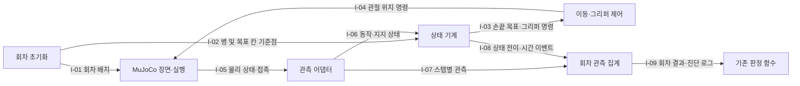

# D06 시스템 구조 — 인쇄면을 보호하는 로봇팔 병목 파지

> D06 · 작성 이동석(시뮬레이션) · 검토 이동석(개발) · 상태 작성 · v0.1 · 관련 R-01~R-06
>
> 4일차 PDF 5–6쪽, 8쪽 참고. 아래 제어·관측 인터페이스는 **구현할 설계**다. 현재 검증 범위는 [장면 v0](scene.md)의 초기 안정성·경로 기하 검사와 별도 단일 병 파지 시험이다. [기존 판정 코드](../src/judge.py)는 완성된 회차 기록을 집계하며, MuJoCo에서 그 기록을 수집하는 코드는 아직 없다.

## 모듈 관계도

### 모듈별 역할: 언제, 어디서, 무엇을 하는가

아래의 ‘어디서’는 소스 파일명이 아니라 회차 실행 흐름에서 맡는 위치다. 장면과 판정 함수는 이미 있지만, 나머지 실행 모듈은 이 구조에 따라 구현할 예정이다.

| 모듈 | 언제 | 어디서 | 무엇을 하는가 |
| --- | --- | --- | --- |
| 회차 초기화 | 자동 시작 전, 회차마다 한 번 | 물리 실행과 상태 기계의 시작점 | v0에서는 고정 배치, 본시험에서는 미리 정한 병 시작 위치와 박스 위치를 장면에 적용한다. 상태 기계에도 병과 빈 칸의 기준점을 넘긴다. 박스는 회차 중 움직이지 않으며 카메라로 빈 칸을 찾지 않는다. |
| 상태 기계 | 자동 시작과 동작 중 관측을 받을 때 | 관측 어댑터와 이동·그리퍼 제어 사이 | 지금 할 일을 고른다. 예를 들어 병목 위치에 도달하면 닫기, 바닥이 병을 지지하면 열기를 지시한다. 상태가 바뀐 시각과 병을 놓은 시각도 남긴다. |
| 이동·그리퍼 제어 | 제어 주기마다 | 상태 기계의 목표를 MuJoCo 명령으로 바꾸는 곳 | 손끝 목표를 팔 관절 6개의 위치 명령으로 변환하고 그리퍼 열기·닫기 목표를 보낸다. 어떤 상태로 넘어갈지나 그 동작의 성공 여부는 판단하지 않는다. |
| MuJoCo 장면·실행 | 초기 배치를 적용한 뒤, 매 물리 스텝 | [장면 v0 MJCF](../scenes/v0.xml)를 실행하는 물리 루프 | 관절 명령을 적용하고 물리 시간을 전진시켜 로봇과 병의 실제 자세·접촉을 계산한다. 뷰어 화면 갱신 여부와 무관하게 물리 관측을 제공한다. |
| 관측 어댑터 | 물리 스텝이 끝날 때마다 | MuJoCo 물리 데이터와 상태 기계·집계 사이 | 같은 스텝의 자세·접촉을 읽어 ‘병목 접촉’, ‘병 몸통 접촉’, ‘칸 바닥 지지’처럼 의미를 붙인다. 지금의 동작 상태는 상태 기계로, 판정에 필요한 스텝별 관측은 집계로 보낸다. |
| 회차 관측 집계 | 회차 중 매 스텝 누적, 필요한 관측이 끝나면 확정 | 관측 어댑터·상태 기계의 출력과 판정 함수 사이 | 접촉·낙하는 한 번이라도 발생하면 그 사실을 보존하고, 안착은 놓은 뒤 1초 동안 유지됐는지 확인한다. 완료된 회차의 관측을 `TrialResult` 한 개로 요약하고 진단 로그는 별도로 남긴다. |
| 기존 판정 함수 | 회차 결과가 나온 뒤. 전체 합격 판정은 본시험 10회 완료 후 | [`src/judge.py`](../src/judge.py) | `judge_episode`는 10회 기록을 요구사항과 비교한다. `judge_cycle_time`은 회차 시간 목표를 따로 판단한다. 두 함수는 MuJoCo나 제어 명령에 직접 접근하지 않는다. |

예를 들어 **병을 내려놓는 순간**에는 MuJoCo가 접촉을 계산하고, 관측 어댑터가 그 접촉을 목표 칸 바닥 지지로 분류한다. 상태 기계는 그 결과를 받아 그리퍼를 연다. 이후 회차 관측 집계가 1초간 안착을 확인하고, 판정 함수는 완성된 회차 기록을 받아 본시험 결과를 판단한다.

## 상태 기계

| 상태 | 지시 | 정상 전이 조건과 이벤트 |
| --- | --- | --- |
| 대기 | 초기 배치 검증, `standby` 자세 유지, 그리퍼 열림 | 자동 시작 시 `t_start` 기록 → 접근 |
| 접근 | 병목 높이의 파지 자세로 접근 | 손끝이 목표 위치·방향에 도달 → 파지 |
| 파지 | 그리퍼를 닫고 양쪽 손가락의 병목 접촉을 확인 | 파지 확인 → 이송 |
| 이송 | 투입 받침에서 병을 들어 올리고 목표 칸 위로 이동 | 실제로 받침을 벗어나 들어 올린 시점 기록. 빈 칸 상부의 목표 자세에 도달 → 배치 |
| 배치 | 병을 수직으로 내려 칸 바닥 지지를 확인한 후 그리퍼 열기 | 병에 대한 그리퍼의 지지가 사라진 시점에 `t_release` 기록 → 후퇴. 이 시점부터 안착 관측 시작 |
| 후퇴·복귀 | 열린 그리퍼를 수직으로 물리고 대기 자세로 복귀 | 병과 떨어진 후퇴 목표에 도달하면 `t_clear`, 대기 자세에 도달하면 `t_standby` 기록 |
| 결과 확정 | 필요한 관측이 끝날 때까지 대기 | 대기 복귀와 `t_release + 1.0 s` 안착 관측이 모두 끝나면 집계한다. 이미 복귀했다면 남은 관측 시간은 사이클타임에 더하지 않는다. |

도달 여부는 실제 자세를 확인해 결정한다. 정상 전이 조건을 충족하지 못해도 다음 상태를 강제로 실행하지 않는다. 제한시간과 정지·종료 정책은 [D08 안전 개념](#d08-안전-개념)을 따른다.

## 인터페이스 표 (ICD)

### 인터페이스 요약

번호는 각 행에서 다시 시작한다. 링크를 누르면 같은 필드명의 상세 표로 이동한다.

| ID | 송신 → 수신 | 전달 데이터 | 전달 시점 |
| --- | --- | --- | --- |
| [I-01](#i-01-trialsetup) | 회차 초기화 → MuJoCo 실행 | 1. `trial_id`: 회차 식별자 2. `bottle_pose`: 대상 병 시작 자세 3. `box_pose`: 박스 자세 4. `standby_q`: 대기 관절 위치 | 회차 시작 전 |
| [I-02](#i-02-tasktargets) | 회차 초기화 → 상태 기계 | 1. `bottle_pose`: 대상 병 시작 자세 2. `target_cell_center`: 빈 칸 바닥 중심 3. `box_pose`: 박스 자세 4. `standby_q`: 대기 관절 위치 | 초기화 완료 후 한 번 |
| [I-03](#i-03-motiongoal) | 상태 기계 → 이동·그리퍼 제어 | 1. `tool_goal`: 손끝 목표 자세 2. `arm_goal_q`: 관절로 지정한 목표 자세 3. `gripper_command`: 그리퍼 동작 요청 | 상태 진입·경로 구간 변경 시, 그 사이 목표 유지 |
| [I-04](#i-04-actuatorcommand) | 이동·그리퍼 제어 → MuJoCo 실행 | 1. `arm_ctrl`: 팔 액추에이터 목표 6개 2. `gripper_ctrl`: 그리퍼 액추에이터 목표 | 제어 주기마다 갱신, 물리 스텝 사이에는 [워치독](#명령-끊김-감시-워치독) 허용 시간 내에서만 마지막 명령 유지 |
| [I-05](#i-05-physicssample) | MuJoCo 실행 → 관측 어댑터 | 1. `step`: 물리 스텝 번호 2. `time_s`: 시뮬레이션 시각 3. `arm_q`: 실제 관절 위치 4. `tool_pose`: 실제 손끝 자세 5. `bottle_pose`: 실제 병 자세 6. `bottle_bottom_velocity`: 병 바닥 중심 속도 7. `contacts`: 물리 접촉 목록 | 매 물리 스텝. 종료 상태의 관측을 갱신한 뒤 복사 |
| [I-06](#i-06-motionfeedback) | 관측 어댑터 → 상태 기계 | 1. `arm_q`: 실제 관절 위치 2. `tool_pose`: 실제 손끝 자세 3. `neck_contacts`: 손가락별 병목 접촉 여부 4. `gripper_support`: 그리퍼 지지 여부 5. `floor_support`: 바닥 지지 종류 6. `bottle_bottom_z`: 병 바닥 중심의 높이 | 매 물리 스텝 관측 후, 다음 명령 판단 전 |
| [I-07](#i-07-trialsample) | 관측 어댑터 → 회차 관측 집계 | 1. `step`: 물리 스텝 번호 2. `time_s`: 시뮬레이션 시각 3. `contact_events`: 판정용 접촉 분류 4. `gripper_support`: 그리퍼 지지 여부 5. `bottle_bottom_z`: 병 바닥 중심의 높이 6. `bottle_bottom_vz`: 병 바닥 중심의 수직 속도 7. `floor_support`: 바닥 지지 종류 8. `bottom_bounds`: 박스 기준 병 바닥 경계 | 매 물리 스텝 관측 후 |
| [I-08](#i-08-stateevent) | 상태 기계 → 회차 관측 집계 | 1. `step`: 대응하는 관측 스텝 2. `time_s`: 이벤트 시각 3. `event`: 전이 또는 판정에 필요한 사건 4. `transition`: 전이 전·후 상태 | 전이·이벤트 발생 시 |
| [I-09](#i-09-trialresult-및-진단-로그) | 회차 관측 집계 → 기존 판정 함수·로그 | 1. `trial_result`: 완료 회차의 판정 입력 2. `diagnostic_log`: 회차 ID, 박스 벽 접촉, 최초 실패·종료 기록 | 관측 완료 후 회차당 하나의 결과. 최종 시험 10회만 전체 판정에 전달 |

### 필드별 상세

위치 벡터의 순서는 `(x, y, z)`, 방향은 단위 쿼터니언 `(w, x, y, z)`다. `Pose`는 위치(`float[3]`, m)와 방향(`float[4]`, 무단위)을 담는다. 각 필드에 명시한 좌표계를 사용하며, 박스 로컬 축은 [D07 기준 배치](scene.md#v0-기준-배치)를 따른다. 관절 벡터는 D07의 팔 관절 순서를 사용하고, MuJoCo 배열로 옮길 때는 액추에이터 이름으로 매핑한다. 아래의 **[v0]**는 장면 초기값(예시는 반올림 가능), 그 밖의 값은 데이터 모양을 보여주는 **설명용 예시**로 실제 실행 결과가 아니다.

#### I-01 TrialSetup

| 데이터 | 의미 | 형식·단위 | 예시 |
| --- | --- | --- | --- |
| `trial_id` | v0 확인과 본시험 회차를 구분하는 식별자 | 문자열 | `"v0-01"` |
| `bottle_pose` | 대상 병 바닥 중심의 시작 위치와 병 방향 | `Pose`, 월드 | **[v0]** 위치 `[0.19399984, -0.06437967, -0.012]`, 방향 `[1, 0, 0, 0]` |
| `box_pose` | 박스 외부 바닥 중심과 박스 방향. 기존 병과 목표 기준점도 박스의 로컬 배치에 맞춰 초기화 | `Pose`, 월드 | **[v0]** 위치 `[0.06984411, 0.21046622, -0.012]`, 방향 `[0.707107, 0, 0, -0.707107]` |
| `standby_q` | 회차를 시작할 때의 팔 대기 자세 | `float[6]`, rad | **[v0]** `[1.503780, -0.403763, 1.852301, 1.571151, -1.638319, -3.019964]` |

#### I-02 TaskTargets

| 데이터 | 의미 | 형식·단위 | 예시 |
| --- | --- | --- | --- |
| `bottle_pose` | 초기화한 대상 병의 자세. 상태 기계는 병 형상의 병목 오프셋을 적용해 접근점을 잡음 | `Pose`, 월드. I-01과 동일 | **[v0]** 바닥 중심 `[0.19399984, -0.06437967, -0.012]` |
| `target_cell_center` | 마지막 빈 칸 바닥 중심. 손끝 목표와는 다른 기준점 | `float[3]`, 월드, m | **[v0]** `[0.10484411, 0.17546622, -0.007]` |
| `box_pose` | 목표 칸 로컬 축을 월드로 변환할 때 사용하는 박스 자세 | `Pose`, 월드. I-01과 동일 | **[v0]** 박스 방향 `[0.707107, 0, 0, -0.707107]` |
| `standby_q` | 후퇴 이후 돌아갈 팔 대기 자세 | `float[6]`, rad. I-01과 동일 | I-01 `standby_q` |

#### I-03 MotionGoal

| 데이터 | 의미 | 형식·단위 | 예시 |
| --- | --- | --- | --- |
| `tool_goal` | 손끝 기준 프레임의 목표 자세. 병·칸 기준점에서 손끝까지의 오프셋을 고려함 | `Pose`, 월드. `arm_goal_q`와 둘 중 하나만 지정 | 위치 `[0.14, -0.065, 0.15]`, 방향 `[0.707107, 0, 0, -0.707107]` |
| `arm_goal_q` | 손끝 대신 관절로 지정하는 팔 목표 자세. 대기 복귀 등에 사용 | `float[6]`, rad 또는 미지정 | I-01 `standby_q` |
| `gripper_command` | 각도 숫자가 아닌 열기·닫기·현재 명령 유지 요청 | 열거형, `OPEN / CLOSE / HOLD` | `CLOSE` |

#### I-04 ActuatorCommand

| 데이터 | 의미 | 형식·단위 | 예시 |
| --- | --- | --- | --- |
| `arm_ctrl` | `data.ctrl`의 팔 액추에이터 6개에 설정할 위치 목표 | 이름 매핑된 `float[6]`, rad | 대기 유지 시 I-01 `standby_q` |
| `gripper_ctrl` | `gripper_controller` 위치 목표. 손가락의 종속 관절은 MJCF 연동 제약이 처리 | `float`, rad | **[v0]** 열림 `0.15` |

#### I-05 PhysicsSample

| 데이터 | 의미 | 형식·단위 | 예시 |
| --- | --- | --- | --- |
| `step` | 회차 안 물리 관측 순번 | `int`, 0부터 시작 | `120` |
| `time_s` | 그 관측 시점의 `data.time` | `float`, 시뮬레이션 s | `0.120` |
| `arm_q` | 팔 관절의 실제 위치. 마지막 명령과 다를 수 있음 | `float[6]`, rad | **[v0]** 초기 관절 위치는 I-01 `standby_q` |
| `tool_pose` | 정의된 손끝 기준 프레임의 실제 자세 | `Pose`, 월드 | 위치 `[0.141, -0.065, 0.151]`인 자세 |
| `bottle_pose` | 이 스텝의 실제 병 바닥 중심과 병 방향 | `Pose`, 월드 | **[v0]** 초기 자세는 I-01 `bottle_pose` |
| `bottle_bottom_velocity` | 측정 지점을 병 바닥 중심으로 통일한 선속도 | `float[3]`, 월드, m/s | `[0, 0, -0.02]` |
| `contacts` | 접촉마다 두 geom의 이름 또는 ID, 접촉점, 부호 있는 간격, 필요 시 병에 작용하는 힘 | 접촉 레코드 목록. 접촉점은 월드 m, 간격은 m, 힘은 월드 N | `bottle_body ↔ target_cell_floor`, 간격 `-0.0003` m |

#### I-06 MotionFeedback

| 데이터 | 의미 | 형식·단위 | 예시 |
| --- | --- | --- | --- |
| `arm_q` | 대기 자세 복귀 여부를 확인하는 실제 관절 위치 | `float[6]`, rad | I-05 `arm_q` |
| `tool_pose` | 손끝이 목표 자세에 도달했는지 비교할 실제 자세 | `Pose`, 월드 | I-05 `tool_pose` |
| `neck_contacts` | 양쪽 손가락의 병목 접촉을 각각 기록 | `(left: bool, right: bool)` | `(true, true)` |
| `gripper_support` | 접촉과 힘으로 판단한 그리퍼의 병 지지 여부 | `bool` | `true` |
| `floor_support` | 병 바닥을 지지하는 면의 종류 | 열거형, `TARGET / OTHER / NONE` | `TARGET` |
| `bottle_bottom_z` | 실제로 들어 올렸는지 확인하는 병 바닥 중심 높이 | `float`, 월드 z, m | **[v0]** 시작 높이 `-0.012` |

#### I-07 TrialSample

| 데이터 | 의미 | 형식·단위 | 예시 |
| --- | --- | --- | --- |
| `step` | 판정 관측을 이벤트와 연결하는 번호 | `int`, I-05와 동일 | `120` |
| `time_s` | 안착 지속 시간과 사건 시각을 기록하는 기준 | `float`, 시뮬레이션 s | `0.120` |
| `contact_events` | 관측 스텝에서 발견한 접촉 분류와 근거 접촉쌍 | 분류·geom 쌍의 목록. 분류 예: `PRINT / NEIGHBOR / BOX_WALL / SECONDARY` | `BOX_WALL`: `bottle_body ↔ box_wall_x2` |
| `gripper_support` | 낙하 판정에 사용할 현재 그리퍼 지지 여부 | `bool`, I-06과 동일 | `false` |
| `bottle_bottom_z` | 바닥 중심의 수직 위치 | `float`, 월드 z, m | `0.03` |
| `bottle_bottom_vz` | 바닥 중심 속도의 수직 성분. 음수면 하강 | `float`, 월드 z축, m/s | `-0.02` |
| `floor_support` | 낙하와 정상 배치·오배치를 구분하는 바닥 지지 | 열거형, I-06과 동일 | `NONE` |
| `bottom_bounds` | 병 바닥 원판이 차지하는 범위. 중심만 검사하지 않음 | `float[4]` `(x_min, x_max, y_min, y_max)`, 박스 로컬, m | `[0.010, 0.060, 0.010, 0.060]` |

#### I-08 StateEvent

| 데이터 | 의미 | 형식·단위 | 예시 |
| --- | --- | --- | --- |
| `step` | 같은 시점의 `TrialSample`을 찾는 물리 스텝 번호 | `int` | `2800` |
| `time_s` | 전이 또는 사건이 관측된 시뮬레이션 시각 | `float`, 시뮬레이션 s | `2.8` |
| `event` | 전이, 자동 시작, 들기 확인, 병을 놓음, 후퇴 완료, 대기 복귀를 구분. 시간 필드는 해당 이벤트의 시각 | 열거형, `TRANSITION / START / LIFTED / RELEASE / CLEAR / STANDBY` | `RELEASE` 이벤트의 `time_s`가 `t_release` |
| `transition` | 상태 전이가 함께 발생한 경우 전이 전·후 상태 | 상태 쌍 또는 미지정 | `(배치, 후퇴·복귀)` |

#### I-09 TrialResult 및 진단 로그

| 데이터 | 의미 | 형식·단위 | 예시 |
| --- | --- | --- | --- |
| `trial_result` | 기존 판정 함수에 전달하는 완료 회차의 기록. 개별 필드의 의미는 [회차 결과 기준](#회차-결과를-만드는-기준) 참고 | 기존 `TrialResult`: bool 4개와 `elapsed_s: float`(s) | `seated=true`, `elapsed_s=4.1` (일부 필드) |
| `diagnostic_log` | 결과와 별도로 회차 ID·종료 이유, 박스 벽 접촉 여부, 최초 실패 시각·근거 접촉쌍을 남김 | 구조화 레코드. `box_wall_contact`는 bool, ID·종료 이유는 문자열, 최초 실패 시각은 s 또는 미지정, 접촉쌍은 이름 2개 또는 미지정 | `trial_id="v0-01"`, `box_wall_contact=true`, `end_reason="COMPLETED"`, `first_failure_time_s=null` |

구현 시 물리 스텝 종료 자세에 대해 접촉·힘을 갱신한 후 복사한다. 예를 들어 `mj_step` 뒤 `mj_forward`로 관측을 갱신하면 추가 시간 진행 없이 종료 상태를 읽을 수 있다. 접촉 힘을 사용할 때는 `mj_contactForce`의 접촉 좌표계 출력을 월드 좌표계로 변환하고, geom 순서에 따라 **병에 작용하는** 힘의 방향을 적용한다. [MuJoCo 시뮬레이션 루프](https://mujoco.readthedocs.io/en/3.3.7/programming/simulation.html#simulation-loop) · [MuJoCo 접촉 힘 API](https://mujoco.readthedocs.io/en/3.3.7/APIreference/APIfunctions.html#mj-contactforce)

## 회차 결과를 만드는 기준

장면을 로드할 때 geom 이름과 소속 body로 분류표를 한 번 만든다. 로봇은 `g_base` 하위 충돌 geom, 기존 병은 `bottle_placed_1`~`bottle_placed_3` 소속 geom, 박스 벽은 `box_wall_*`을 사용한다. 대상 병의 보호 영역은 `bottle_body` 전체다. 접촉쌍의 순서는 무시하고, 양의 간격을 가진 후보 접촉은 실제 접촉으로 집계하지 않는다.

| `TrialResult` 필드 | 관측에서 만드는 규칙 | D03 |
| --- | --- | --- |
| `print_contact` | `t_start`부터 `t_clear`까지 로봇과 `bottle_body`가 한 번이라도 접촉하면 `True`로 고정한다. 손가락의 뚜껑·어깨 접촉은 별도 로그로 남기고 몸통 접촉으로 세지 않는다. | R-01 / T-01 |
| `dropped` | 실제로 들어 올린 뒤부터 바닥에 지지될 때까지, 바닥 지지 없이 그리퍼 지지를 잃고 병 바닥이 아래로 움직인 경우 `True`로 고정한다. 빈 칸 위 공중에서 열어 떨어뜨린 경우도 포함한다. 지지한 채 다른 바닥에 내려놓으면 오배치이지 낙하는 아니다. | R-02 / T-02 |
| `seated` | `t_release`부터 시뮬레이션 시간 1초 동안 매 스텝, 병이 **자기 바닥면**으로 `target_cell_floor`에 지지되고 바닥면 전체가 칸 내부에 있어야 `True`다. 한 스텝이라도 지지를 잃거나 이탈하면 `False`. 정상 해제·관측이 없으면 안착 성공을 기록하지 않는다. | R-03 / T-03 |
| `neighboring_bottle_contact` | `t_start`부터 `t_clear`까지 로봇이나 대상 병이 기존 병 geom과 한 번이라도 접촉하면 `True`로 고정한다. | R-04 / T-04 |
| `elapsed_s` | 실제 대기 복귀 시각에서 자동 시작 시각을 뺀다(`t_standby - t_start`). 목표 상한은 예비 시험 후 본시험 전에 초 단위로 확정한다. | R-05 / T-05 |

**진단 로그 — `box_wall_contact` (R-06 / T-06):** 접근부터 후퇴까지 로봇 또는 대상 병이 `box_wall_*`과 접촉하면 `true`로 기록한다. `target_cell_floor`의 정상 지지만 있으면 `false`다. 이 필드는 `TrialResult`에 넣거나 판정 함수에 전달하지 않는다.

### 지지와 칸 경계

- **그리퍼 지지:** 파지 진입 확인에는 양쪽 손가락의 병목 접촉을 요구한다. 이송 중 지지 판정에는 손가락 접촉과 병에 작용하는 지지력을 함께 본다. 손가락의 뚜껑·어깨 접촉만으로 병목 파지 성공을 선언하지 않는다. 접촉 노이즈에 대한 수치 허용오차는 예비 시험에서 정하되, 바닥 지지 없는 하강을 정상 배치로 바꾸지 않는다.
- **바닥 지지:** `bottle_body` 접촉 위치를 병 로컬 좌표로 바꿔 몸통 원통의 아랫면인지 확인하고, 바닥에서 병으로 작용하는 위쪽 지지력을 확인한다. `target_cell_floor`와의 옆면 접촉이나 박스 벽에 기대는 것은 목표 칸 바닥 지지가 아니다. `support`와 다른 칸 바닥은 목표 칸과 구분해 기록한다.
- **칸 경계:** 목표 칸의 박스 로컬 `x, y` 내부 범위는 각각 `[0.0025, 0.0675]` m다. 바닥 원판 중심과 축을 박스 좌표로 변환한다. 반지름이 `r`, 병 축 단위벡터의 축별 성분이 `aᵢ`이면 바닥 원판의 해당 축 극값은 중심 좌표 `± r√(1 − aᵢ²)`로 검사한다. 중심만 칸 안에 있는 것으로 판정하지 않으며, 별도 기울기 합격 각도를 두지 않는다.

### 결과 기록과 집계

- 회차 결과와 진단 이벤트는 분리한다. v0 확인은 본시험 집계에서 제외한다. 본시험은 사전 정의한 서로 다른 회차 ID 10개의 기록만 순서대로 `judge_episode`에 전달하고, 시간 목표는 `judge_cycle_time`으로 따로 확인한다.
- 회차가 중단되어 `t_standby`가 없다면 `elapsed_s`를 0이나 경과 시간으로 대체하지 않는다. [D08](#d08-안전-개념)에 따라 해당 회차의 중단 기록을 남긴다. 완전한 `TrialResult`가 없는 회차를 성공 기록으로 대체하지 않는다.

## D08 안전 개념

> D08 · 작성 이동석(시뮬레이션) · 검토 이동석(QA·운영) · 상태 작성 · v0.1
>
> 4일차 PDF 7쪽의 표 형식을 따른다. 이 절은 **MuJoCo 회차의 정지·기록 규칙**이며, 실물 로봇의 안전 기능을 정의하거나 검증한 것이 아니다.

| 로봇 | 하면 안 되는 일 | 감지 | 막는 동작 |
| --- | --- | --- | --- |
| 병목 파지 로봇팔 | 팔이나 그리퍼가 대상 병의 인쇄면에 닿음 (**R-01 / T-01**) | 접근 시작부터 후퇴 완료까지 매 물리 스텝에서 로봇 geom과 대상 병의 `bottle_body` 접촉을 확인한다. 손가락의 병목·뚜껑·어깨 접촉은 몸통 접촉으로 세지 않는다. | 병목을 목표로 접근한다. 몸통 접촉이 한 번이라도 검출되면 `print_contact`를 실패 기록에 남기고 해당 회차를 즉시 정지한다. |
| 병목 파지 로봇팔 | 병을 들어 올린 뒤 이송 중 놓치거나 공중에서 내려놓음 (**R-02 / T-02**) | 실제로 들어 올린 뒤 바닥 지지 없이 그리퍼 지지를 잃고, 병 바닥이 아래로 움직였는지 확인한다. | 바닥 지지가 확인되기 전에는 열기 명령을 보내지 않는다. 낙하가 검출되면 `dropped`를 실패 기록에 남기고 해당 회차를 즉시 정지한다. |
| 병목 파지 로봇팔 | 팔·그리퍼 또는 대상 병이 기존 세 병 중 하나에 닿음 (**R-04 / T-04**) | 접근 시작부터 후퇴 완료까지 매 물리 스텝에서 로봇이나 대상 병과 `bottle_placed_1`~`bottle_placed_3` 소속 geom의 접촉을 확인한다. | 기존 병과 간섭하지 않는 경로로 접근·하강한다. 접촉이 한 번이라도 검출되면 `neighboring_bottle_contact`를 실패 기록에 남기고 해당 회차를 즉시 정지한다. |
| 병목 파지 로봇팔 | 제어 명령이 끊긴 뒤에도 이전 명령으로 계속 움직임 (**워치독**) | MuJoCo 실행 모듈이 물리 스텝을 진행하기 전에 마지막으로 유효한 새 I-04 명령을 받은 시점부터의 경과 시간을 검사한다. | 제한시간에 도달하면 이전 명령을 더 적용하지 않고 현재 회차의 물리 진행을 중단한다. 그리퍼를 자동으로 열지 않으며, 진단 로그에 `COMMAND_TIMEOUT`을 남긴 뒤 초기화하여 다음 예정 회차로 진행한다. |
| 병목 파지 로봇팔 | 정상 전이 조건이 충족되지 않은 채 다음 동작을 실행하거나 현재 동작을 무기한 계속함 | 단계별 도달·파지·바닥 지지 조건을 확인하고, 해당 단계의 제한시간이 지났는지 확인한다. | 조건이 충족되지 않으면 다음 동작을 실행하지 않는다. 제한시간을 넘으면 해당 회차를 중단하고 원인을 기록한다. 단계별 제한시간은 예비 시험에서 정하며, R-05의 사이클타임 목표와는 별개다. |

### 명령 끊김 감시 (워치독)

- 회차의 첫 물리 스텝 전에 유효한 제어 명령을 한 번 받아야 한다. 그 이후에는 **완전하고 유효한 새 명령을 받을 때만** 워치독을 갱신한다. 같은 목표를 유지하라는 명령도 새로 받았다면 유효하다. 반대로 새 입력 없이 `data.ctrl`에 남은 값을 재사용하는 것은 갱신으로 세지 않는다.
- 제한시간은 **시뮬레이션 시간**으로 계산한다. PDF 7쪽의 0.5초는 예시이며, 이 프로젝트의 값은 제어 주기를 측정한 뒤 예비 시험에서 확정한다. 워치독은 **명령 갱신이 끊겼는지**를 검사한다. 명령이 계속 들어오는데도 동작을 완료하지 못한 경우를 처리하는 단계별 제한시간이나 R-05 사이클타임 목표와는 다르다.
- 명령 끊김으로 중단하면 회차 ID, 마지막 유효 명령 시각, 감지 시각을 기록한다. 관측되지 않은 인쇄면 접촉·낙하·기존 병 접촉을 임의로 실패값에 넣지 않는다.

### 정지 후 다음 회차

1. **현재 회차만 정지:** 금지 상황을 감지한 스텝의 상태를 보존하고, 새 동작 명령과 다음 물리 스텝을 실행하지 않는다. 정지를 위해 그리퍼를 자동으로 열거나 복귀 동작을 실행하지 않는다.
2. **실패 기록 보존:** 진단 로그에 회차 ID, 종료 이유, 최초 실패 시각, 상태, 관측 근거(접촉쌍 또는 지지 상실·하강)를 남긴다. 대기 복귀 전에 정지했다면 사이클타임은 미측정으로 기록하고 `TrialResult`를 꾸며 내지 않는다. **R-01·R-02·R-04 위반이 확인되면** 나머지 회차가 성공해도 본시험은 불합격이다.
3. **다음 예정 회차로 진행:** 기록 저장 후 초기화 모듈이 다음 회차의 배치·대기 자세·명령·관측 상태를 초기화한다. 초기화가 확인되면 사전에 정한 **다음 회차 ID**로 시작한다. 실패한 배치를 같은 회차로 재시도하거나, 실패 중간 상태에서 자동 복구하지 않는다. 다음 회차 자체를 정상 초기화하지 못하면 그 회차를 실행하지 말고 초기화 오류를 남긴다.

**박스 벽 접촉(R-06 / T-06)만** 발생한 경우는 `box_wall_contact`를 진단 로그에 남기고 회차를 계속한다. 목표 칸 바닥의 정상 지지는 벽 접촉이 아니며, 다른 금지 상황이 함께 발생하면 해당 금지 상황의 정지 규칙을 적용한다.
