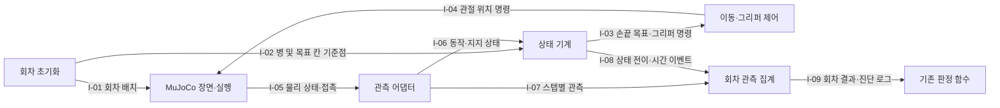

# D06 시스템 구조 — 인쇄면을 보호하는 로봇팔 병목 파지

> D06 · 작성 이동석(시뮬레이션) · 검토 이동석(개발) · 상태 작성 · v0.1 · 관련 R-01~R-06
>
> 4일차 PDF 5–6쪽, 8쪽 참고. 아래 제어·관측 인터페이스는 **구현할 설계**다. 현재 검증 범위는 [장면 v0](scene.md)의 초기 안정성·경로 기하 검사와 별도 단일 병 파지 시험이다. [기존 판정 코드](../src/judge.py)는 완성된 회차 기록을 집계하며, MuJoCo에서 그 기록을 수집하는 코드는 아직 없다.

## 모듈 관계도

- **초기화**는 v0에서 고정 배치를, 최종 시험에서는 사전 정의한 회차별 배치를 적용한다. 박스를 회차 중 움직이지 않는다. 영상 인식이나 빈 칸 탐색 대신 대상 병과 목표 칸의 기준점을 제어에 제공한다.
- **상태 기계**는 동작 순서와 이벤트를 소유한다. **이동·그리퍼 제어**는 손끝 목표를 관절 위치 명령으로 변환하지만 성공 여부는 판단하지 않는다.
- **MuJoCo 실행**은 명령을 적용하고 물리 시간을 진행한다. **관측 어댑터**는 물리 스텝마다 동일한 시점의 자세·접촉을 읽고, **회차 관측 집계**는 그 관측을 한 번의 `TrialResult`로 요약한다. 뷰어 갱신과 접촉 수집 주기는 분리한다.

## 상태 기계

| 상태 | 지시 | 정상 전이 조건과 이벤트 |
| --- | --- | --- |
| 대기 | 초기 배치 검증, `standby` 자세 유지, 그리퍼 열림 | 자동 시작 시 `t_start` 기록 → 접근 |
| 접근 | 병목 높이의 파지 자세로 접근 | 손끝이 목표 위치·방향에 도달 → 파지 |
| 파지 | 그리퍼를 닫고 양쪽 손가락의 병목 접촉을 확인 | 파지 확인 → 이송 |
| 이송 | 투입 받침에서 병을 들어 올리고 목표 칸 위로 이동 | 실제로 받침을 벗어나 들어 올린 시점 기록. 빈 칸 상부의 목표 자세에 도달 → 배치 |
| 배치 | 병을 수직으로 내려 칸 바닥 지지를 확인한 후 그리퍼 열기 | 병에 대한 그리퍼의 지지가 사라진 시점에 `t_release` 기록 → 후퇴. 이 시점부터 안착 관측 시작 |
| 후퇴·복귀 | 열린 그리퍼를 수직으로 물리고 대기 자세로 복귀 | 병과 떨어진 후퇴 목표에 도달하면 `t_clear`, 대기 자세에 도달하면 `t_standby` 기록 |
| 결과 확정 | 필요한 관측이 끝날 때까지 대기 | 대기 복귀와 `t_release + 1.0 s` 안착 관측이 모두 끝나면 집계한다. 이미 복귀했다면 남은 관측 시간은 사이클타임에 더하지 않는다. |

도달 여부는 실제 자세를 확인해 결정한다. 정상 전이 조건을 충족하지 못해도 다음 상태를 강제로 실행하지 않는다. 제한시간, 정지·종료 정책은 5단계 D08에서 정하며, 자동 재시도는 범위 밖이다.

## 인터페이스 표 (ICD)

공통 표기: 월드·박스 로컬 위치는 `float[3]` m, 방향은 단위 쿼터니언 `float[4]` `(w, x, y, z)`, 관절 위치는 rad, 시간은 MuJoCo 시뮬레이션 초(s)다. 박스 로컬 좌표는 [D07](scene.md#v0-기준-배치)을 따른다. `Pose`는 위치·방향·좌표계, 접촉 항목은 이름/ID·부호 있는 거리(m)·월드 접촉 위치(m)·필요 시 병에 작용하는 힘(N)을 포함한다.

| ID | 송신 → 수신 | 데이터 형식·의미 | 전달 시점 |
| --- | --- | --- | --- |
| I-01 | 회차 초기화 → MuJoCo 실행 | `TrialSetup`: 회차 ID, 대상 병 시작 위치, 박스 자세, 대기 관절 위치. 박스 로컬 배치를 기준으로 기존 병과 목표 기준점도 일관되게 초기화 | 회차 시작 전 |
| I-02 | 회차 초기화 → 상태 기계 | `TaskTargets`: 대상 병 바닥 중심과 자세, 월드 목표 칸 바닥 중심(`target_cell_center`), 박스 자세, 대기 관절 위치. 병목 기준점은 D07의 병 형상으로부터 계산 | 초기화 완료 후 한 번 |
| I-03 | 상태 기계 → 이동·그리퍼 제어 | `MotionGoal`: 목표 손끝 `Pose` 또는 대기 관절 위치, 그리퍼 `OPEN / CLOSE / HOLD`. 손끝 기준 프레임과 그리퍼 오프셋은 제어 모듈이 일관되게 적용 | 상태 진입·경로 구간 변경 시, 그 사이 목표 유지 |
| I-04 | 이동·그리퍼 제어 → MuJoCo 실행 | 이름이 지정된 팔 위치 목표 6개와 `gripper_controller` 목표 1개를 `data.ctrl`에 기록. 손가락 종속 관절은 MJCF 연동 제약이 처리 | 제어 주기마다 명령 갱신, 물리 스텝 사이에는 마지막 명령 유지 |
| I-05 | MuJoCo 실행 → 관측 어댑터 | `PhysicsSample`: 스텝 번호·`data.time`, 팔 관절·손끝 자세, 대상 병 자세·속도(m/s), 접촉쌍과 접촉 위치·거리·힘. 시간과 자세·접촉은 같은 물리 상태에서 복사 | 매 물리 스텝. 명령 적용 → 시간 진행 → 스텝 종료 상태의 관측 갱신 → 스냅샷 |
| I-06 | 관측 어댑터 → 상태 기계 | `MotionFeedback`: 실제 손끝·관절 자세, 손가락별 병목 접촉, 그리퍼 지지 여부, 바닥 지지 종류(목표/기타/없음), 병 높이 | 매 물리 스텝 관측 후. 상태 기계는 최신값으로 다음 명령 결정 |
| I-07 | 관측 어댑터 → 회차 관측 집계 | `TrialSample`: 시뮬레이션 시각, 접촉 분류, 그리퍼 지지, 병 바닥의 높이·속도, 지지하는 바닥, 박스 로컬에서의 병 바닥 경계 | 매 물리 스텝 관측 후 |
| I-08 | 상태 기계 → 회차 관측 집계 | `StateEvent`: 상태 전이·시각, `t_start`, 들기 확인, `t_release`, `t_clear`, `t_standby`. 이벤트와 관측은 같은 스텝 번호로 연결 | 전이·이벤트 발생 시 |
| I-09 | 회차 관측 집계 → 기존 판정 함수·로그 | `TrialResult`: 아래 표의 bool 5개와 `elapsed_s: float`. 별도 회차 로그에 최초 실패 시각·접촉쌍, 회차 ID, 종료 이유 기록 | 관측 완료 후 회차당 1개. 최종 시험 10개만 전체 판정에 전달 |

구현 시 물리 스텝 종료 자세에 대해 접촉·힘을 갱신한 후 복사한다. 예를 들어 `mj_step` 뒤 `mj_forward`로 관측을 갱신하면 추가 시간 진행 없이 종료 상태를 읽을 수 있다. 접촉 힘을 사용할 때는 `mj_contactForce`의 접촉 좌표계 출력을 월드 좌표계로 변환하고, geom 순서에 따라 **병에 작용하는** 힘의 방향을 적용한다. [MuJoCo 시뮬레이션 루프](https://mujoco.readthedocs.io/en/3.3.7/programming/simulation.html#simulation-loop) · [MuJoCo 접촉 힘 API](https://mujoco.readthedocs.io/en/3.3.7/APIreference/APIfunctions.html#mj-contactforce)

## 회차 결과를 만드는 기준

장면을 로드할 때 geom 이름과 소속 body로 분류표를 한 번 만든다. 로봇은 `g_base` 하위 충돌 geom, 기존 병은 `bottle_placed_1`~`bottle_placed_3` 소속 geom, 박스 벽은 `box_wall_*`을 사용한다. 대상 병의 보호 영역은 `bottle_body` 전체다. 접촉쌍의 순서는 무시하고, 양의 간격을 가진 후보 접촉은 실제 접촉으로 집계하지 않는다.

| `TrialResult` 필드 | 관측에서 만드는 규칙 | D03 |
| --- | --- | --- |
| `print_contact` | `t_start`부터 `t_clear`까지 로봇과 `bottle_body`가 한 번이라도 접촉하면 `True`로 고정한다. 손가락의 뚜껑·어깨 접촉은 별도 로그로 남기고 몸통 접촉으로 세지 않는다. | R-01 / T-01 |
| `dropped` | 실제로 들어 올린 뒤부터 바닥에 지지될 때까지, 바닥 지지 없이 그리퍼 지지를 잃고 병 바닥이 아래로 움직인 경우 `True`로 고정한다. 빈 칸 위 공중에서 열어 떨어뜨린 경우도 포함한다. 지지한 채 다른 바닥에 내려놓으면 오배치이지 낙하는 아니다. | R-02 / T-02 |
| `seated` | `t_release`부터 시뮬레이션 시간 1초 동안 매 스텝, 병이 **자기 바닥면**으로 `target_cell_floor`에 지지되고 바닥면 전체가 칸 내부에 있어야 `True`다. 한 스텝이라도 지지를 잃거나 이탈하면 `False`. 정상 해제·관측이 없으면 안착 성공을 기록하지 않는다. | R-03 / T-03 |
| `neighboring_bottle_contact` | `t_start`부터 `t_clear`까지 로봇이나 대상 병이 기존 병 geom과 한 번이라도 접촉하면 `True`로 고정한다. | R-04 / T-04 |
| `elapsed_s` | 실제 대기 복귀 시각에서 자동 시작 시각을 뺀다(`t_standby - t_start`). 목표 상한은 예비 시험 후 본시험 전에 초 단위로 확정한다. | R-05 / T-05 |
| `box_wall_contact` | 접근부터 후퇴까지 로봇 또는 대상 병이 `box_wall_*`과 접촉하면 `True`로 고정한다. 목표 칸 바닥과의 정상 지지는 벽 접촉이 아니다. 이 값만으로 본시험 합격을 뒤집지 않는다. | R-06 / T-06 |

### 지지와 칸 경계

- **그리퍼 지지:** 파지 진입 확인에는 양쪽 손가락의 병목 접촉을 요구한다. 이송 중 지지 판정에는 손가락 접촉과 병에 작용하는 지지력을 함께 본다. 손가락의 뚜껑·어깨 접촉만으로 병목 파지 성공을 선언하지 않는다. 접촉 노이즈에 대한 수치 허용오차는 예비 시험에서 정하되, 바닥 지지 없는 하강을 정상 배치로 바꾸지 않는다.
- **바닥 지지:** `bottle_body` 접촉 위치를 병 로컬 좌표로 바꿔 몸통 원통의 아랫면인지 확인하고, 바닥에서 병으로 작용하는 위쪽 지지력을 확인한다. `target_cell_floor`와의 옆면 접촉이나 박스 벽에 기대는 것은 목표 칸 바닥 지지가 아니다. `support`와 다른 칸 바닥은 목표 칸과 구분해 기록한다.
- **칸 경계:** 목표 칸의 박스 로컬 `x, y` 내부 범위는 각각 `[0.0025, 0.0675]` m다. 바닥 원판 중심과 축을 박스 좌표로 변환한다. 반지름이 `r`, 병 축 단위벡터의 축별 성분이 `aᵢ`이면 바닥 원판의 해당 축 극값은 중심 좌표 `± r√(1 − aᵢ²)`로 검사한다. 중심만 칸 안에 있는 것으로 판정하지 않으며, 별도 기울기 합격 각도를 두지 않는다.

### 결과 기록과 집계

- 회차 결과와 진단 이벤트는 분리한다. v0 확인은 본시험 집계에서 제외한다. 본시험은 사전 정의한 서로 다른 회차 ID 10개의 기록만 순서대로 `judge_episode`에 전달하고, 시간 목표는 `judge_cycle_time`으로 따로 확인한다.
- 회차가 중단되어 `t_standby`가 없다면 `elapsed_s`를 0이나 경과 시간으로 대체하지 않는다. 관측한 실패와 종료 이유를 진단 로그에 남기고 해당 회차가 정상 완료되지 않았음을 표시한다. 불완전한 본시험에 합격 판정을 내리지 않는다. 중단 시 장비 동작과 기록 정책은 D08에서 구체화한다.
