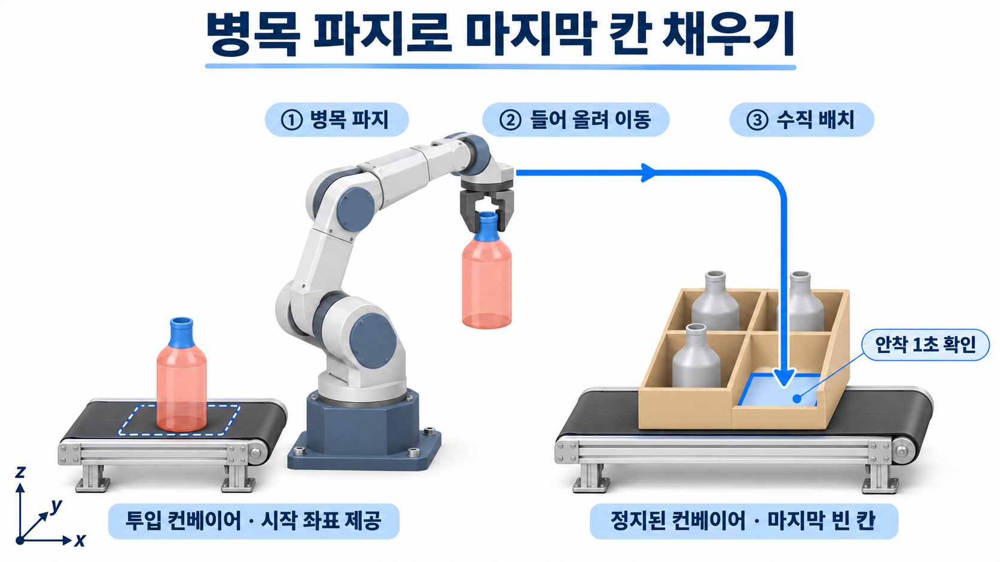

# D02 팀 차터 — 인쇄면을 보호하는 로봇팔 병목 파지

> D02 · 팀 차터 · 작성 이동석(PM) · 검토 이동석(자체 검토) · 상태 작성 · v0.1

## 목표 한 줄

MuJoCo에서 로봇팔이 병목을 잡아 몸통 인쇄면을 보호하며 정지한 B라인 컨베이어 벨트 위 2×2 박스의 마지막 칸에 병을 안착시키는 동작을 검증한다.

## 범위

| 구분        | 내용                                                                                                                                                                                         |
| --------- | ------------------------------------------------------------------------------------------------------------------------------------------------------------------------------------------ |
| 한다(In)    | 충전·밀봉·외관 검사가 끝난 병 1개를 병목으로 잡아 정지한 B라인 컨베이어 벨트 위 2×2 박스의 마지막 빈 칸에 넣는다. 장면 v0은 박스를 고정해 점검하고, 최종 시험은 병 시작 위치와 벨트 위 박스 정지 위치를 회차 초기화 때 설정한다. 병 시작 좌표와 목표 칸 좌표를 제어 코드에 전달한다. 회차마다 인쇄면 접촉, 낙하, 목표 칸 안착, 기존 병 접촉을 판정하고 박스 벽 접촉과 사이클타임을 기록한다. 시연 영상과 반복 시험 결과표를 남긴다. |
| 안 한다(Out) | 카메라 기반 상품 인식, 뚜껑 불량 판정, 자동 재시도·실패 복구, 컨베이어 벨트 구동, 움직이는 박스 추적, 실물 로봇 시험.                                                                                                                                            |

최종 시험은 사전에 정한 병 시작 좌표와 벨트 위 박스 정지 위치의 10쌍을 각 1회씩 시험한다. 인쇄면 접촉, 이송 중 낙하, 기존 병 접촉이 각각 0회이고 목표 칸 안착이 9회 이상이면 합격이다. 안착은 병을 놓은 뒤 1초 동안 관측하며, 세부 판정 기준은 [D03 요구사항 명세](requirements.md)를 따른다.

## 플랫폼 결정

MuJoCo에서 구현한다. 실물 로봇팔의 기준은 **myCobot 280 M5Stack**, 그리퍼 후보는 **myCobot 280 Adaptive Gripper**로 둔다. 사용할 MuJoCo 모델은 해당 구성에 대응하는 모델을 확보할 수 있는지, 손끝이 뚜껑과 어깨 사이에 들어가 병목을 잡고 들어 올릴 수 있는지 확인한 뒤 확정한다.

## 역할

| 역할 | 이름 | 맡는 산출물 |
| --- | --- | --- |
| PM | 이동석 | D02, D03, D05 |
| 시뮬레이션 | 이동석 | D06, D07, D08 |
| 개발 | 이동석 | 저장소, 판정 함수 |
| QA·운영 | 이동석 | D04 |

## 일하는 방식
- 작업일마다 한 일, 막힌 일, 다음 할 일을 기록한다.
- 범위, 모델 또는 판정 기준을 바꾸면 이동석이 결정하고 이유를 작업 기록에 남긴다.
- D03의 관측 조건을 모든 회차에 동일하게 적용한다.
- 저장소: 

## 참조 이미지
### 최종 프로젝트 목표

### mujoco프로젝트 에서 활용할 상품 B의 형태

### mujoco 프로젝트 3D 이미지
