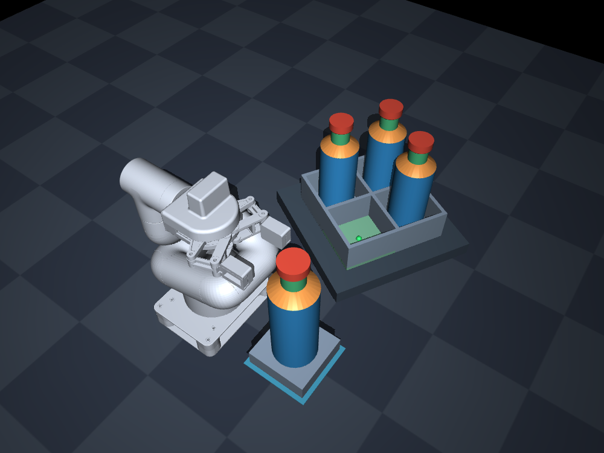

# D07 장면 구성표 — 병목 파지 장면 v0

> D07 · 작성 이동석(시뮬레이션) · 검토 이동석(PM) · 상태 작성 · v0.1
>
> 아래 수치는 장면 v0을 위한 가정값이다. 실물 측정값이나 파지 가능성을 검증한 사양이 아니다. 길이는 m, 질량은 kg로 적는다.

## 구성

| 항목 | 이름 | 개수 | 형상·규격 | 질량·초기 상태 |
| --- | --- | ---: | --- | --- |
| 로봇 모델 | 로봇팔·그리퍼 | 1세트 | [팀 차터](charter_v2.md)의 myCobot 280 M5Stack + Adaptive Gripper. 단일 병 시험을 통과한 제조사 URDF와 MuJoCo 구동 구성을 v0의 기반으로 쓴다. | 베이스 고정. v0 초기 상태는 아래 대기 자세와 열린 그리퍼를 사용한다. |
| 작업 물체 | `bottle_target`, `bottle_placed_1`~`bottle_placed_3` | 4 | 동일한 원통형 단순 모델. 전체 높이 0.150, 몸통 지름 0.050, 병목 지름 0.024, 뚜껑 지름 0.030 | 병 하나당 0.150. 대상 병은 투입 구역에, 기존 병은 각각 지정 칸 중앙에 직립한다. |
| 고정물 | `packing_box` | 1 | 2×2 박스. 한 칸의 내부 가로 × 세로 × 깊이: 0.065 × 0.065 × 0.040. 외벽·칸막이·바닥 두께: 각 0.005 | `conveyor_belt` 위에 놓고 회차 중에는 고정한다. v0에서는 박스 위치를 한 곳으로 고정한다. |
| 고정물 | `conveyor_belt` | 1 | B라인 적재 구간을 0.200 × 0.200 × 0.020(진행 방향 길이 × 폭 × 두께)의 정지한 벨트 표면으로 단순화한다. 모터·롤러 및 벨트 구동은 모델링하지 않는다. | 회차 중 정지 상태인 고정물. |
| 고정물 | `pickup_zone` | 1 | 투입 구역은 작업면의 0.080 × 0.080 영역으로 표시한다. | 기준 회차에서 병 바닥 중심은 구역 중앙에 놓는다. 구역 표시는 충돌 형상으로 쓰지 않는다. |

제조사 모델의 출처, 로드·단일 병 파지 시험 기록, 병과 칸의 충돌 형상 세부 정의는 [병목 파지 모델 검토 및 시험 기록](scene-model-notes.md)에 정리했다.

## v0 기준 배치

아래 좌표는 로봇 베이스가 원점인 MuJoCo 월드 좌표 `(x, y, z)`이며 단위는 m다. 위에서 봤을 때 로봇 베이스에서 투입구 중앙과 컨베이어 중앙을 향하는 방향은 **90°**를 이룬다. 벨트 좌표의 원점은 적재 구간 **윗면 중앙**이다. 벨트 진행 방향을 로컬 `+x`, 폭 방향을 `+y`로 두며, 투입대와 컨베이어·박스의 모서리는 위에서 봤을 때 로봇 베이스의 모서리와 평행하다. 투입대는 월드 회전 0°, 컨베이어와 박스는 월드 `+z`축 기준 −90°다. 투입대와 컨베이어 자체의 밑면을 바닥(`z = -0.032`)에 직접 놓으며 별도 다리를 사용하지 않는다. 대상 병은 투입대 윗면에, 박스는 벨트 윗면에, 기존 병은 각 칸의 바닥에 놓는다.

| 기준점 | 월드 좌표 (m) |
| --- | --- |
| 투입 구역 중앙 = 대상 병 바닥 중심 | `(0.19399984, -0.06437967, -0.012)` |
| 벨트 윗면 중앙 = 박스 외부 바닥 중심 | `(0.06984411, 0.21046622, -0.012)` |
| 마지막 빈 칸 바닥 중심 | `(0.10484411, 0.17546622, -0.007)` |

빈 칸 바닥 중심은 박스 로컬 좌표 `(+0.035, +0.035, +0.005)`다. 기존 병 세 개는 나머지 칸 중앙에 직립시킨다.

관절 각도는 아래 순서대로 rad 단위이며, 표는 낮춘 장면에서 다시 계산한 기준점이다.

| 자세 | `joint2_to_joint1` | `joint3_to_joint2` | `joint4_to_joint3` | `joint5_to_joint4` | `joint6_to_joint5` | `joint6output_to_joint6` |
| --- | ---: | ---: | ---: | ---: | ---: | ---: |
| 대기 (그리퍼 열림, `gripper_controller=0.15`) | 1.50378043 | -0.40376298 | 1.85230090 | 1.57115064 | -1.63831924 | -3.01996357 |
| 투입 병목 파지 위치 | 1.50377918 | -0.34368283 | 2.29565762 | 1.06771958 | -1.63832048 | -3.01996943 |
| 빈 칸 바닥까지 내린 위치 | 2.85640203 | -0.36399169 | 2.25191576 | 1.13177073 | -1.63832071 | -3.01996985 |

### 접근 경로 검사

```bash
uv run --locked python scripts/check_v0_layout.py
```

대기 자세에서 45 mm 수직 하강한 뒤 닫기 → 60 mm 상승 → 로봇 베이스 주위로 약 77.50° 회전 → 빈 칸 바닥까지 수직 하강 → 열기 → 수직 후퇴 순으로 확인했다. 회전 구간은 컨베이어 중앙이 아니라 빈 칸을 목표로 하므로 설비 배치 각도 90°와 다르다. 실제 장면 v0에서 **674개 자세**를 검사했고, 바닥·투입대·박스 벽·컨베이어·기존 병 및 대상 병 몸통과의 금지 접촉이 없었다. 손가락의 병목·뚜껑·어깨 접촉과 의도한 바닥 지지는 허용했다.

이 검사는 이송 구간의 병을 경로상에 직립시킨 **기하 검사**다. 자세 사이의 연속 충돌, 로봇 자체 충돌, 실제 제어에 따른 미끄러짐·낙하·안착은 검증하지 않았다. 이 배치를 [장면 v0 MJCF](../scenes/v0.xml)에 반영했다.

## 장면 v0 실행과 확인

저장소 루트에서 처음에만 제조사 고정 버전의 로봇 파일을 내려받아 MuJoCo 형식으로 변환한다. 생성된 `scenes/_mycobot/`은 Git에 포함하지 않는다. 이후에는 네트워크 없이 장면을 검사할 수 있다.

```bash
uv run --locked --with trimesh==5.2.2 --with pycollada==0.9.3 \
  python scripts/prepare_v0_robot.py
uv run --locked python scripts/check_v0_scene.py
```

마지막 명령에 `--viewer`를 붙이면 대기 자세에서 MuJoCo 뷰어가 열린다. `--screenshot docs/scene-v0.png`를 붙이면 1초 대기 후의 화면을 저장한다. `--top-down`을 추가하면 수직 상공에서 촬영한다.

```text
PASS: both platforms sit directly on the floor; base-aligned edges, center angle 90.000°
PASS: 4 bottles, total 0.600 kg
PASS: 3 occupied cells, 1 empty target cell (+x, +y)
PASS: standby held for 1.000 s; max bottle drift 0.572 mm
PASS: only bottle-base support contacts; all 4 bottles supported after settling
```



[위에서 본 장면: 로봇 베이스와 투입대·벨트 모서리 정렬](scene-v0-top.png)

초기 대기 상태의 겹침과 안정성만 검증했다. 전체 집기·이송·배치 사이클과 최종 10회 시험 결과는 포함하지 않는다.

### 최종 시험에 남은 일

[최종 시험](requirements.md)에서는 벨트를 정지 상태로 유지하고 회차 초기화 때만 박스 위치를 바꾼다. 박스 바닥 전체가 벨트 적재 구간 안에 놓이고 로봇이 목표 칸에 접근할 수 있는 범위를 확인한 뒤, 병 시작 좌표와 박스 위치의 10쌍을 본시험 전에 정한다. 각 회차의 병 시작 좌표와 목표 칸 좌표는 초기화 때 제어 코드에 전달한다.

## 검증 기준

- **XML·초기 배치:** XML 로드 성공, 병 4개, 병 질량 합 0.600 kg. 박스 바닥이 벨트 표면에 놓인다. 기존 병 3칸 점유, 목표 칸 1칸 비움, 대상 병은 투입 구역에 직립한다. 한 칸에 병이 중앙으로 들어가면 가정 치수 기준 좌우 여유는 각각 0.0075 m다. 실제 접근·배치 여유는 그리퍼를 포함해 별도로 확인한다.
- **뷰어:** 초기 자세와 몇 스텝 뒤 배치에서 의도하지 않은 겹침, 튀어 오름, 병 넘어짐이 없다. 통과한 장면의 스크린샷과 수치 검증 출력을 남긴다.
- **파지 가능성:** 양쪽 손가락이 병목에 닿은 채 몸통에 닿지 않고 병을 들어 올리는지 확인한다. 손가락의 뚜껑·어깨 접촉은 별도 기록한다. XML과 초기 배치 검증만으로 파지 성공을 판정하지 않는다.
